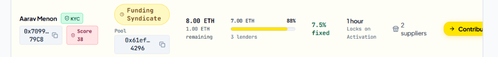
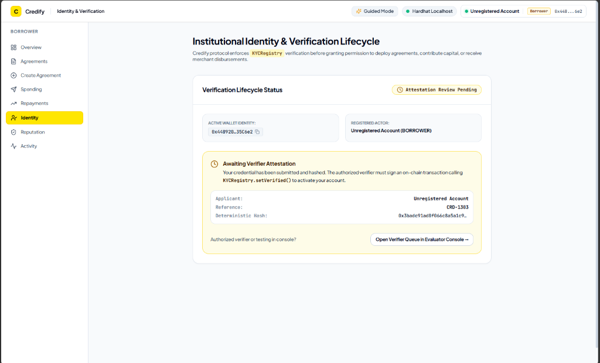
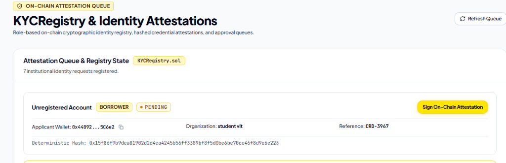
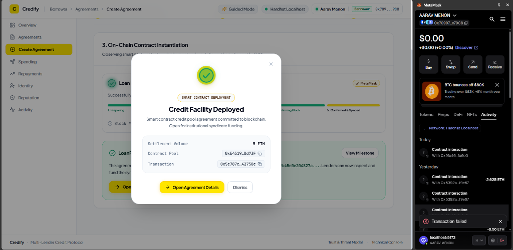
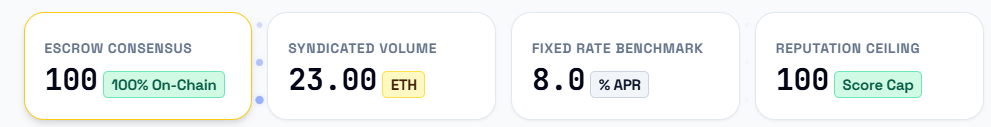
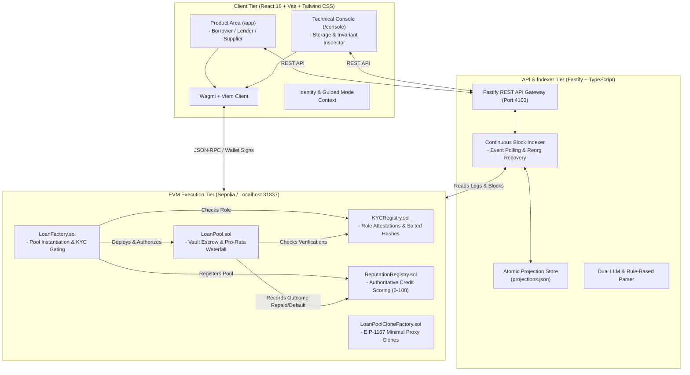
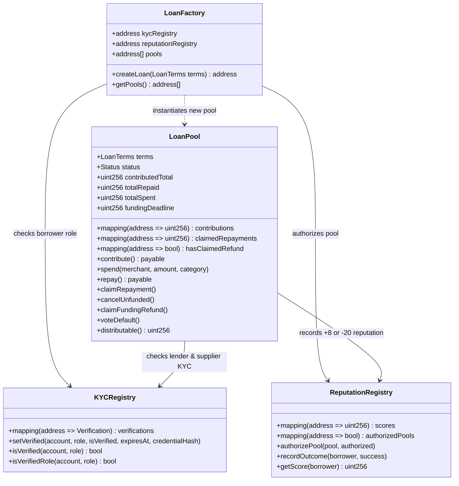
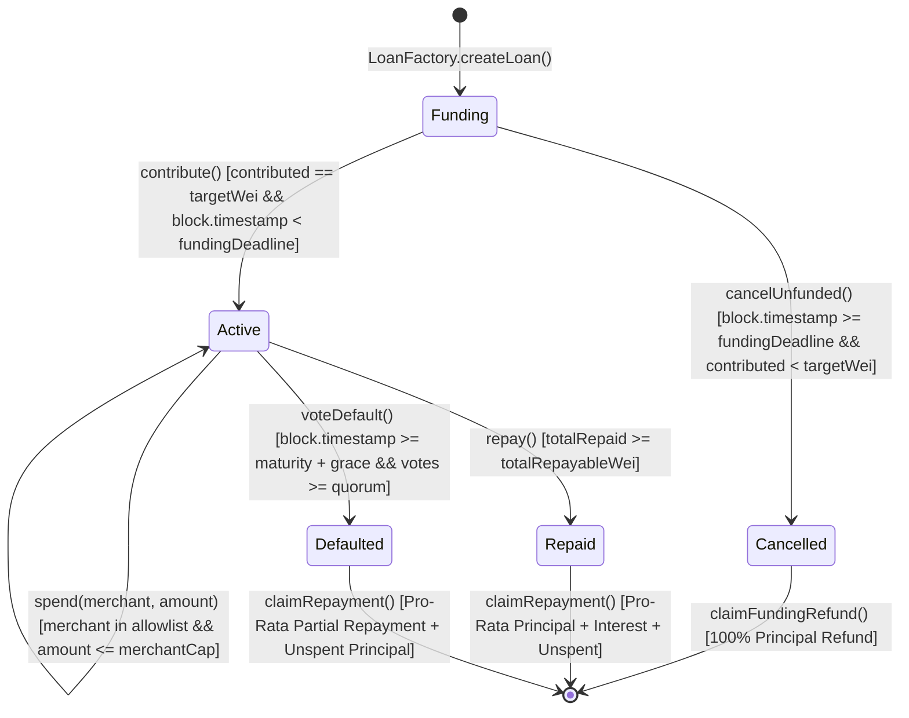
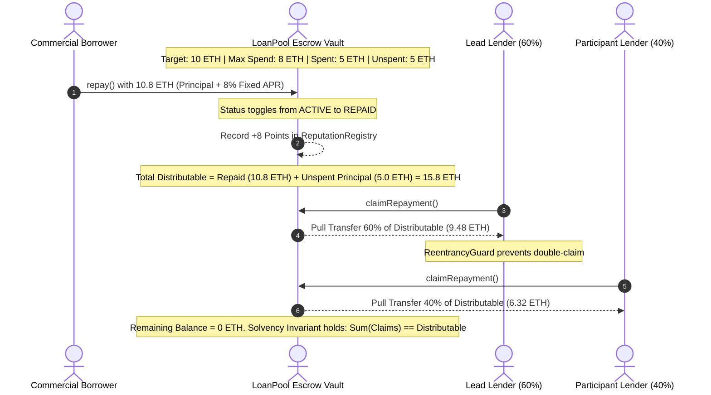

# Credify — Decentralized Multi-Lender Credit Protocol

> **An institutional-grade, deployable Ethereum syndicated credit protocol featuring cryptographic agreement binding, allowlisted supplier disbursements, non-locking pro-rata waterfall repayment, deterministic reputation scoring, and EIP-1167 minimal proxy cloning.**

[](https://soliditylang.org/)
[-627eea.svg?style=flat&logo=ethereum)](https://sepolia.etherscan.io)
[](https://hardhat.org/)
[](https://www.typescriptlang.org/)
[](https://fastify.dev/)
[](https://react.dev/)
[](https://tailwindcss.com/)
[](docs/EIP1167_GAS_ANALYSIS.md)
[-brightgreen.svg?style=flat)](contracts/test/)
[](LICENSE)

---

## 📌 Project Showcase & Quick Links

| Resource | Target Link / Description |
| :--- | :--- |
| 🚀 **Live Web Application (Vercel)** | [https://credify-demo.vercel.app](https://credify-demo.vercel.app) *(Replace with your Vercel deployment URL)* |
| ⚡ **Live Backend API (Render)** | [https://credify-api.onrender.com](https://credify-api.onrender.com) *(Replace with your Render API URL)* |
| 🎥 **Video Demo & Architecture Walkthrough** | [https://youtu.be/YOUR_DEMO_VIDEO](https://youtu.be/YOUR_DEMO_VIDEO) *(Paste your YouTube/Loom video link here)* |
| 📑 **Architecture & Formal Theory Paper** | [`docs/Credify_Architecture_and_Theory.pdf`](docs/Credify_Architecture_and_Theory.pdf) |
| 📜 **Sepolia Deployment Manifest** | [`contracts/deployments/sepolia.json`](contracts/deployments/sepolia.json) |

---

## 📜 Verified Smart Contracts on Ethereum Sepolia

The core smart contract protocol is deployed and verified on the **Ethereum Sepolia Testnet** (`chainId: 11155111`):

| Smart Contract | Sepolia Contract Address | Source Code & Verification |
| :--- | :--- | :--- |
| **`KYCRegistry.sol`** | [`0xdf8d6C4b9a982a4c7a557686cb0A6dF6ECab0236`](https://sepolia.etherscan.io/address/0xdf8d6C4b9a982a4c7a557686cb0A6dF6ECab0236#code) | [](https://sepolia.etherscan.io/address/0xdf8d6C4b9a982a4c7a557686cb0A6dF6ECab0236#code) |
| **`ReputationRegistry.sol`** | [`0xA989eeBcBe4A850D591c3678A3c9Cb84f18DC0ca`](https://sepolia.etherscan.io/address/0xA989eeBcBe4A850D591c3678A3c9Cb84f18DC0ca#code) | [](https://sepolia.etherscan.io/address/0xA989eeBcBe4A850D591c3678A3c9Cb84f18DC0ca#code) |
| **`LoanFactory.sol`** | [`0xD5230D26a83E15da5b4F22b9b06054F96FB47c89`](https://sepolia.etherscan.io/address/0xD5230D26a83E15da5b4F22b9b06054F96FB47c89#code) | [](https://sepolia.etherscan.io/address/0xD5230D26a83E15da5b4F22b9b06054F96FB47c89#code) |
| **`LoanPool.sol`** *(Sample Instance)* | [`0x35af7C36B06342e172049e6859e7D58Eb9b420A1`](https://sepolia.etherscan.io/address/0x35af7C36B06342e172049e6859e7D58Eb9b420A1#code) | [](https://sepolia.etherscan.io/address/0x35af7C36B06342e172049e6859e7D58Eb9b420A1#code) |
| **Deployer & Protocol Operator** | [`0x448920c465158b78A694460E96E022b82B35C6e2`](https://sepolia.etherscan.io/address/0x448920c465158b78A694460E96E022b82B35C6e2) | Deployment Block: `#11954224` |

---

## 🖼️ Visual Protocol Walkthrough & Interface Tour

The Credify interface is structured around a strict separation between **Institutional Operations (`/app`)** and the **Technical Governance & Invariant Console (`/console`)**.

### 1. Syndicate Capital Allocation & Capacity Explorer
Lenders discover open loan facilities, inspect terms, verify allowlisted suppliers, and contribute capital toward the all-or-nothing target before the `fundingDeadline`.


*Figure 1: Lender Explore Portal displaying an 8.00 ETH syndicate pool at 88% subscription (7.00 ETH contributed, 750 bps fixed APR, 30-minute tenor, approved supplier constraints, and live funding window).*

---

### 2. On-Chain Cryptographic Identity & Verification Lifecycle
`KYCRegistry.sol` enforces role-based permissions (`Borrower`, `Lender`, `Supplier`). Credentials are bound to salted hashes (`credentialHash`) on-chain before any actor can instantiate pools or commit capital.


*Figure 2: Institutional Identity Lifecycle view displaying connected wallet identity (`0x4489...`), role gating, deterministic verification digest, and verifier queue routing.*

---

### 3. Evaluator Attestation Queue & Registry State
Authorized verifiers inspect submitted credential digests and execute `KYCRegistry.setVerified()` on-chain.


*Figure 3: On-Chain Attestation Queue within the Evaluator Console, detailing applicant reference IDs (`CRD-3967`), organization metadata, and one-click cryptographic attestation signing.*

---

### 4. Vault Solvency & Pro-Rata Waterfall Inspector
The Technical Console provides transparent visibility into contract escrow balances, unspent capital reserves, and mathematical pro-rata dividend tracking.


*Figure 4: Real-time loan ledger inspection illustrating exact mathematical pro-rata dividend claims, debt-service waterfall distribution, and zero capital-lock guarantees.*

---

### 5. Smart Contract Policy Guardrails & Rejection Handling
The interface catches and explains all on-chain policy violations (e.g., borrower self-funding prevention, unauthorized supplier disbursements, or expired funding windows) before EVM broadcast.


*Figure 5: Policy rejection drawer explaining smart contract invariants, custom revert errors (`BorrowerCannotContribute()`, `FundingClosed()`), and EVM storage implications.*

---

## 🏛️ Comprehensive Architecture & Design

### 1. End-to-End System Topology



---

### 2. Smart Contract Ecosystem & Role Interactions



---

### 3. Complete State Machine Lifecycle (`LoanPool.sol`)

The lifecycle of each syndicated credit facility follows a deterministic finite state machine enforced by immutable smart contract logic:



---

### 4. Non-Locking Pro-Rata Waterfall Distribution Flow



---

## 📐 Mathematical Formulation & Protocol Invariants

### 1. All-or-Nothing Funding Discipline
A syndicate facility activates if and only if full subscription is attained prior to the deadline:
$$\text{Activation Condition} \iff \sum_{i=1}^{n} C_i = T \quad \land \quad t_{\text{current}} < t_{\text{deadline}}$$
where $C_i$ is the contribution of lender $i$, $T$ is `targetWei`, and $t_{\text{deadline}}$ is `fundingDeadline`. If $t_{\text{current}} \ge t_{\text{deadline}}$ and $\sum C_i < T$, the pool transitions to `Status.Cancelled`.

### 2. Allowlisted Spend Caps
Drawdowns cannot exceed either individual merchant limits or the aggregate spend ceiling:
$$\forall j \in M, \quad \sum \text{Disbursed}_j \le \text{Cap}_j \quad \land \quad \sum_{j \in M} \text{Disbursed}_j \le S_{\max} \le T$$
where $M$ is the set of allowlisted merchants, $\text{Cap}_j$ is `merchantCapsWei[j]`, and $S_{\max}$ is `maxSpendWei`.

### 3. Non-Locking Distributable Capital
When a facility is settled or defaulted, unspent escrowed principal is merged with debt service:
$$D_{\text{total}} = \text{Total Repaid} + \left( T - \text{Total Spent} \right)$$
Each lender's claimable balance is computed strictly via pull-payment accounting:
$$\text{Claimable}_i = \left\lfloor \frac{C_i}{T} \times D_{\text{total}} \right\rfloor - \text{Already Claimed}_i$$

### 4. Vault Solvency Conservation Law
At any point in time, the sum of all liabilities cannot exceed the contract's real ETH balance:
$$\sum_{i=1}^{n} \text{Claimable}_i + \left( T - \text{Total Spent} \right) \le \text{address}(\text{this}).\text{balance}$$

### 5. Default Consensus Quorum
Default declaration requires a stake-weighted supermajority vote following the grace period:
$$t_{\text{current}} \ge t_{\text{maturity}} + t_{\text{grace}} \quad \land \quad \sum_{k \in V} C_k \ge \left\lfloor \frac{T \times Q_{\text{bps}}}{10000} \right\rfloor$$
where $V$ is the set of affirmative lender voters and $Q_{\text{bps}}$ is `defaultQuorumBps` (typically $> 5000$, or $> 50\%$).

---

## 🛡️ Smart Contract Security & Threat Matrix

| Threat Vector | Attack Scenario | On-Chain Defense Implemented in Credify |
| :--- | :--- | :--- |
| **Reentrancy** | Malicious supplier or lender reenters `spend()` or `claimRepayment()` during external ETH transfer. | OpenZeppelin `ReentrancyGuard` (`nonReentrant` modifier) + **Checks-Effects-Interactions** pattern (internal accounting updated prior to `.call{value: ...}("")`). |
| **Borrower Self-Funding** | Borrower contributes to their own syndicate to wash trade or manipulate progress. | Strict verification in `contribute()`: `if (msg.sender == borrower) revert BorrowerCannotContribute();`. |
| **Capital Diversion / Embezzlement** | Borrower attempts to withdraw raw ETH to an unvetted personal wallet. | Zero raw withdrawal functions exist. Funds can only disburse via `spend()` to addresses confirmed with `Role.Supplier` in `KYCRegistry.sol`. |
| **Capital Trapping** | Underfunded pool expires or unspent principal remains locked in vault. | `cancelUnfunded()` unlocks 100% principal refunds. In active pools, `distributable()` automatically refunds unspent principal alongside repayment dividends. |
| **Front-Running / Nonce Desync** | User submits contribution right as funding window expires. | Explicit block-timestamp deadline check in `LoanPool.sol`: `if (block.timestamp >= fundingDeadline) revert FundingClosed();`. |
| **Sybil Credit Farming** | Attacker creates self-funded micro-loans to artificially inflate credit score to 100. | [`WeightedReputationRegistry.sol`](contracts/contracts/reputation/WeightedReputationRegistry.sol) scales credit gains by principal volume tiers and caps reputation based on counterparty lender diversity ($< 2$ lenders capped at 65; $< 4$ lenders capped at 80). |

---

## ⚡ Gas Profiling & EIP-1167 Minimal Proxy Clone Benchmarks

Credify includes an implementation of **EIP-1167 Minimal Proxy Cloning** ([`LoanPoolCloneFactory.sol`](contracts/contracts/clones/LoanPoolCloneFactory.sol)), enabling protocol participants to deploy new syndicated loan instances at a fraction of standard deployment gas costs.

### Hardhat Gas Benchmark Results

| Deployment Architecture | Gas Consumed | Cost @ 30 gwei | Cost @ 50 gwei | Net Gas Reduction |
| :--- | :--- | :--- | :--- | :--- |
| **Standard Factory (`new LoanPool`)** | **2,787,646 gas** | 0.0836 ETH | 0.1394 ETH | Baseline |
| **EIP-1167 Proxy (`Clones.clone`)** | **580,339 gas** | 0.0174 ETH | 0.0290 ETH | **79.18% Savings** |
| **Absolute Savings per Loan Pool** | **-2,207,307 gas** | **-0.0662 ETH** | **-0.1104 ETH** | **>2.2 Million Gas** |

*Verified via automated gas test suite: `npm run test:gas -w contracts`.*

---

## 📁 Monorepo Workspace Structure

```text
Credify/
├── contracts/                        # Solidity 0.8.24 Smart Contracts & Hardhat Workspace
│   ├── contracts/
│   │   ├── LoanPool.sol              # Core Escrow Vault & Waterfall Settlement
│   │   ├── LoanFactory.sol           # Parameterized Factory & KYC Verification Gating
│   │   ├── KYCRegistry.sol           # Role-Based Access Control & Credential Hashes
│   │   ├── ReputationRegistry.sol    # Authoritative Credit Scoring (0-100)
│   │   ├── LoanTypes.sol             # Shared Data Structures (LoanTerms, Status Enums)
│   │   ├── clones/
│   │   │   ├── LoanPoolCloneable.sol # Initializable Minimal Proxy Variant
│   │   │   └── LoanPoolCloneFactory.sol # EIP-1167 Clones Factory
│   │   └── reputation/
│   │       └── WeightedReputationRegistry.sol # Sybil-Resistant Tiered Scoring
│   ├── deployments/
│   │   ├── sepolia.json              # Live Sepolia Deployment Addresses & Block #
│   │   └── local.json                # Local Hardhat Node Deployment Manifest
│   ├── scripts/                      # Deployment (deploy.ts) & Verification (verify.ts)
│   └── test/                         # 44 Mocha/Chai/Ethers Test Suites
│
├── apps/
│   ├── api/                          # Fastify 5.x Backend & Continuous Chain Indexer
│   │   ├── src/
│   │   │   ├── chain/                # Viem Client, Reorg Detection, Continuous Polling
│   │   │   ├── services/             # LoanService, LLM Term Sheet Parser, Principals
│   │   │   ├── store/                # Atomic JSON Projection Persistence
│   │   │   └── server.ts             # Fastify REST Gateway & Evaluator Endpoints
│   │   └── package.json
│   │
│   └── web/                          # React 18 + Vite 6 + Tailwind CSS Frontend
│       ├── src/
│       │   ├── pages/
│       │   │   ├── borrower/         # Agreements, Spending, Repayments, Reputation
│       │   │   ├── lender/           # Explore Syndicates, Portfolio, Claims, Governance
│       │   │   ├── supplier/         # Disbursements, Verified Profile
│       │   │   ├── console/          # 12 Technical Evaluator Pages & Inspectors
│       │   │   └── LoanDetailPage.tsx# Full Facility Overview & Waterfall Tracker
│       │   ├── components/           # StatusBadge, AddressBadge, Drawers, Modals
│       │   ├── context/              # IdentityContext (Guided Mode) & WalletContext
│       │   └── lib/                  # Wagmi / Viem Config & Standalone Fallback API
│       └── package.json
│
├── packages/
│   └── shared/                       # Shared Domain Package (@credify/shared)
│       └── src/                      # Zod Schemas, ABIs, Demo Principals, Enums
│
├── docs/                             # Architectural Specifications & Reports
│   ├── assets/screenshots/           # UI Walkthrough Screenshots
│   ├── Credify_Architecture_and_Theory.pdf # Formal Academic Theory Paper
│   ├── EIP1167_GAS_ANALYSIS.md       # Proxy Benchmark Report
│   ├── DECISIONS.md                  # Architectural Decision Records (ADRs)
│   ├── SEPOLIA_DEPLOYMENT.md         # 9-Phase Public Testnet Rehearsal Guide
│   └── QUALITY.md                    # Coverage Baseline & Static Analysis Invariants
│
├── render.yaml                       # 1-Click Cloud Deployment Blueprint for Render
├── package.json                      # Monorepo Workspace Root & Orchestration Scripts
└── README.md                         # Primary Documentation
```

---

## ⚡ Quickstart & Local Setup Guide

### 1. Prerequisites
- **Node.js**: `v20.x` or `v22.x` (`node -v`)
- **npm**: `v10.x+`
- **Git**

### 2. Installation
```bash
# Clone the repository
git clone https://github.com/H4R5H1L-27/Credify.git
cd Credify

# Install dependencies across all monorepo workspaces
npm install

# Build shared types package
npm run build:shared
```

### 3. Launch Local Development Stack
You can launch the entire stack across 3 separate terminal sessions:

#### Terminal 1 — Local Hardhat EVM Node (Port 8545)
```bash
npm run chain:node
```
*Spawns a local EVM JSON-RPC node on `http://127.0.0.1:8545` (Chain ID `31337`) funded with 10,000 test ETH across 7 deterministic accounts.*

#### Terminal 2 — Backend API & Event Indexer (Port 4100)
```bash
npm run dev:api
```
*Starts Fastify server, runs automated contract deployment on local node, and indexes on-chain events continuously.*

#### Terminal 3 — Vite Frontend Web Server (Port 5173)
```bash
npm run dev:web
```
*Open `http://localhost:5173` in your browser.*

---

## 🧪 Automated Testing & Verification Suite

The repository contains an exhaustive test suite covering custom errors, reentrancy guards, timing expiration, and mathematical waterfall claims:

```bash
# 1. Run all 44 Smart Contract Tests (100% Pass)
npm run test -w contracts

# 2. Run Test Coverage Analysis (Pool: 97.4%, Factory: 100%, KYC: 95.4%)
npm run test:coverage -w contracts

# 3. Run EIP-1167 Gas Benchmark Tests
npm run test:gas -w contracts

# 4. Run Backend API & Invariant Test Suites (29 suites)
npm run test -w apps/api

# 5. Typecheck Entire Monorepo (0 Errors across all 4 packages)
npm run typecheck

# 6. Verify Production Frontend Build
npm run build -w apps/web
```

---

## 🎭 Dual Operation Modes

The interface incorporates two distinct modes for testing and demonstration:

1. **🌟 Guided Demo Mode (Default, Zero-Setup)**:
   - Evaluators can walk through the entire protocol without MetaMask or test ETH.
   - Use the **Persona Switcher** in the header to alternate instantly between **Aarav Menon (Borrower)**, **Meera Capital (Lead Lender)**, and **BuildRight Supplies (Supplier)**.
   - Operations execute seamlessly against the active blockchain environment.

2. **🦊 Real Web3 / MetaMask Mode**:
   - Connect any browser wallet (MetaMask, Rabby, Coinbase Wallet).
   - Switch network to **Ethereum Sepolia Testnet**.
   - Sign real on-chain transactions directly on the deployed Sepolia contracts.

---

## 📄 License & Academic Integrity

Distributed under the **MIT License**. Created as an academic showcase of decentralized commercial credit facilities, deterministic reputation tracking, and trust-minimized on-chain escrow custody.
